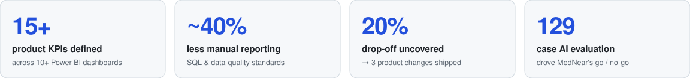

<a href="https://akshita-r-portfolio.netlify.app"></a>

<p align="center">
  <a href="https://akshita-r-portfolio.netlify.app"></a>
  <a href="https://akshita-r-portfolio.netlify.app/?mode=recruiter"></a>
  <a href="https://akshita-r-portfolio.netlify.app/assets/resume.pdf"></a>
  <a href="https://linkedin.com/in/akshita-r"></a>
  <a href="mailto:akshitar2003@gmail.com"></a>
</p>

I sit where **data, users and product decisions** meet. 1.5+ years in enterprise SaaS analytics, backend engineering in a fintech product team before that, and one product I took from **a user survey to a live launch**. I'm now moving into **product management**.

### Impact

<picture>
  <source media="(prefers-color-scheme: dark)" srcset="assets/impact-dark.svg" />
  
</picture>

### How I make a product call

The hardest decision on **[MedNear](https://mednearproduct.netlify.app)**, an AI-assisted medicine-availability app I built 0→1, was what **not** to ship:

```yaml
# MedNear: the go / no-go call
question:  "Where should I go now?"        # one user question, from survey + personas
success_metric: stock_accuracy >= 80%      # written in the PRD before building

launch_bar:                                # set BEFORE testing
  emergencies_caught: ">= 95%"
  lookup_accuracy:    ">= 90%"

eval_set: 129 cases                        # brands, salts, typos, Hindi, Kannada, emergencies
results:
  rules_on_known_cases:      100%
  emergencies_on_blind_set:  20%           # far below the bar

decision:
  ship:      medicine_lookup               # closed/out-of-stock suggestions 30% → 0%, taps 2 → 1
  hold_back: ai_triage
  fallback:  urgent_help_route
  guardrail: eval runs in CI on every change
```

<sub>Full story → <a href="https://akshita-r-portfolio.netlify.app/case.html?id=mednear">MedNear case study</a></sub>

### Featured work

| | | |
|---|---|---|
| 💊 **[MedNear](https://akshita-r-portfolio.netlify.app/case.html?id=mednear)** | AI medicine finder, 0→1 · PRD, Supabase, Gemini API | Live app · AI triage held back on evidence |
| 📊 **[Product KPIs @ CSG](https://akshita-r-portfolio.netlify.app/case.html?id=kpi-dashboards)** | 15+ KPIs · 10+ Power BI dashboards · 6-person pipeline | ~40% less reporting · 25% less rework |
| 🅿️ **[Urban Parking Analytics](https://akshita-r-portfolio.netlify.app/case.html?id=urban-parking)** | Real-time occupancy pipeline · Python, MongoDB, AWS | ₹50K grant · patent filed · 2× finalist |
| 🛒 **[E-commerce Funnel](https://akshita-r-portfolio.netlify.app/case.html?id=ecommerce-funnel)** | SQL funnel + 5+ cohort dashboards · MySQL, Power BI | Found the 23% cart → checkout leak |

### Experience

| Role | Where | When |
|---|---|---|
| **Data Analyst**, Product & Analytics | CSG Systems International | Feb 2025 – present |
| **Backend Engineer**, Product Team | Volopay | Apr 2024 – Feb 2025 |
| **B.E. Computer Science** · CGPA 8.78 | CMR Institute of Technology | 2021 – 2025 |

### How I work

- **Metric first.** I write down what "working" means before anything gets built.
- **Find the leak.** Funnels and cohorts over dashboards nobody reads.
- **Ship what's true.** If the evaluation says "not yet", the feature waits.
- **Team sport.** Years of state-level hockey taught me to read the play and trust my teammates.

### Toolkit

**Product** · User research · PRDs · MVP scoping · RICE · KPIs · Funnel analysis · Agile/Scrum  
**AI product** · Evaluation sets · Launch criteria · Human-in-the-loop design

<p>
  
  
  
  
  
  
  
  
  
  
  
  
</p>

### Recognition

🏑 State-level hockey player · 🏆 ₹50K grant + patent filed (Urban Parking) · Srishti 2024 & Smart Argothon 2023 finalist · Merit Scholarship · Best Mini-Project (Sem 1–5) · President, Rise Club · 5th, WIE Competition

---

<p align="center">
  <b>Open to Associate Product Manager & Product Analyst roles.</b><br />
  <a href="mailto:akshitar2003@gmail.com">akshitar2003@gmail.com</a> · <a href="https://akshita-r-portfolio.netlify.app">akshita-r-portfolio.netlify.app</a>
</p>
